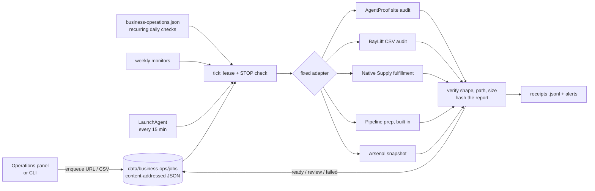

# Business Ops Autopilot

A local, deterministic job queue that runs a small portfolio's recurring business operations (site audits, CSV audits, catalog checks, sales-meeting prep, data snapshot reports) through fixed adapters, keeps hash-verified reports, and surfaces only the exceptions a human needs to handle.

It is the Operations tab of [Omega](https://github.com/ianroyes-sys), Ian's local dashboard, published here as a standalone worker with its tests, a LaunchAgent template and the extracted Next.js panel.

## Why

The goal was "I take the meetings, the machine prepares the work". Most automation for that goes wrong in the same ways: a report that ran gets treated as a customer delivery, a missing send history gets read as "zero emails sent", a stale snapshot looks current, or two workers process the same job. This worker is built around refusing those shortcuts. It has no model, no tool selection and no email sender. It runs fixed adapters, verifies what they return, and records every outcome.

## Features

- **Content-addressed jobs**: a job ID is a hash of the business plus its input (URL + day, CSV hash, or day for daily checks), so repeat submissions reuse the existing job instead of duplicating work. Jobs are published with an atomic hard-link, which is safe under concurrent intake.
- **Five fixed adapters**: public website evidence audit (AgentProof), declined-work CSV audit (BayLift), download-archive fulfillment check (Native Supply), sales pipeline meeting prep (built in), and a data snapshot report (Arsenal Index).
- **Verified artifacts**: a report must be JSON inside that attempt's own output folder and under 4 MB. Its SHA-256 is stored on the job; if the file changes later, reading it fails with "Report changed after verification".
- **Bounded retries**: only website fetches that failed with evidence of a temporary problem (HTTP 408/429/5xx, DNS timeout, connection reset) retry automatically, after 15 and then 60 minutes, three attempts in total. Robots denials, permanent errors and parser exceptions go straight to review.
- **Public-URL scope**: site audits accept only `https://` origins with no credentials, port, path, query or fragment, and reject localhost, private ranges and `.local`/`.internal`/`.test` hosts.
- **Kernel lease**: a small Python helper (`run_lease.py`) uses `flock` plus a PID directory so two ticks never process at once, including stale-owner recovery.
- **Pause and STOP**: a pause file under `data/business-ops/` stops work between jobs; a root `STOP` file also halts it, and resuming from the UI cannot clear a root `STOP`.
- **Daily and weekly schedules**: recurring daily checks come from the registry; explicit weekly website monitors can be paused without being deleted. An optional canary monitor watches a site you own.
- **Exception alerts**: `operationAlerts()` returns a stale worker, corrupt job files, or the newest failed or review job per daily check, URL or CSV, ready to feed a "needs you" list.
- **Sales prep without sending**: the pipeline adapter excludes suppressed and already-contacted leads using the send ledger, attaches follow-up drafts to open deals, and reports send eligibility as *unknown* when no send guard is configured.

## How it works



Each tick: acquire the lease, stop if paused, enqueue today's recurring checks and due weekly monitors, mark any job left `running` by a crashed worker as `failed`, then process up to eight queued jobs, oldest first. Adapters run as child processes with only `PATH` in their environment, so provider keys are not inherited.

## Tech stack

- Node.js 20.11+ (ES modules, `node:test`), no npm dependencies
- Python 3 standard library for the lease helper
- macOS `launchd` for scheduling (template included)
- Next.js App Router + React + CSS Modules for the optional panel (`omega-ui/`)

## Getting started

```bash
git clone https://github.com/ianroyes-sys/business-ops-autopilot.git
cd business-ops-autopilot
npm test          # 15 tests: queue, retries, lease, STOP, monitors, pipeline adapter
npm run demo      # throwaway queue + fixture adapter, prints jobs, counts and alerts
npm run status    # status packet for this checkout (uses data/*.sample.json until you add real files)
```

Run the real worker:

```bash
cp data/business-operations.sample.json data/business-operations.json   # then edit
node scripts/business-ops.mjs enqueue agentproof https://example.com
node scripts/business-ops.mjs enqueue baylift data/example/declined-work.sample.csv --declined-only
node scripts/business-ops.mjs tick
```

The adapters are separate projects. By default the worker looks for them next to this checkout (`../AgentProof`, `../BayLift`, `../native-supply`, `../arsenal-index`). Override with the `BUSINESS_OPS_*_DIR` variables in `.env.example`. Published adapter repos:

- [agentproof-evidence-audit](https://github.com/ianroyes-sys/agentproof-evidence-audit): `scripts/evidence-audit.mjs`
- [baylift-declined-work](https://github.com/ianroyes-sys/baylift-declined-work): `scripts/audit-file.mjs`
- [native-supply-agentic-store](https://github.com/ianroyes-sys/native-supply-agentic-store): `scripts/fulfillment-check.mjs`

The Arsenal Index snapshot adapter (`data/operations_report.py`) is not published. Without an adapter checkout, that job fails with a clear message and stays failed until you retry it.

For the sales pipeline adapter, point `BUSINESS_OPS_PIPELINE_DIR` at a folder shaped like `data/example/pipeline/`.

Schedule it on macOS:

```bash
./launchd/install.sh    # fills the plist template with this path and your node, then loads it
```

### The panel

`omega-ui/` holds the Operations panel (`BusinessOperations.tsx`), its API route and a shared-key guard. It is extracted source for a Next.js App Router project, not a standalone app. Set `BUSINESS_OPS_KEY` and send it as the `business_ops_key` cookie or `x-business-ops-key` header.

## Project structure

```
scripts/
  business-ops.mjs        Queue, adapters, verification, monitors, alerts, CLI
  business-ops.test.mjs   node:test suite (fixture adapters + built-in pipeline adapter)
  run_lease.py            flock-guarded PID lease used by every tick
  demo.mjs                Offline demo in a temp folder
data/
  business-operations.sample.json         Registry: businesses + recurring checks
  business-portfolio-review.sample.json   Optional per-business autonomy review
  example/                                Fake CSV and sales-pipeline records
launchd/                  LaunchAgent template + installer
omega-ui/                 Next.js panel, API route, guard, type shim
```

## Status

The worker, lease and tests run standalone; the demo and the built-in pipeline adapter work with only this repo. In Omega it has run every 15 minutes on Ian's Mac since September 2026. It is Mac-local scheduling, not hosted 24/7 infrastructure, and a "ready" report means a verified local artifact, not a delivered or paid customer order. The panel type-checks against Next.js and React types but needs a Next.js host. All bundled data is fictional.

Built by [Ian Royes](https://github.com/ianroyes-sys)
